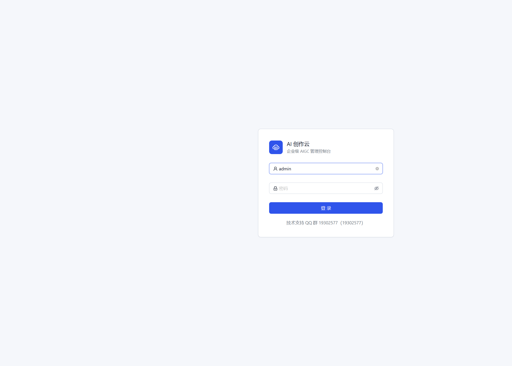
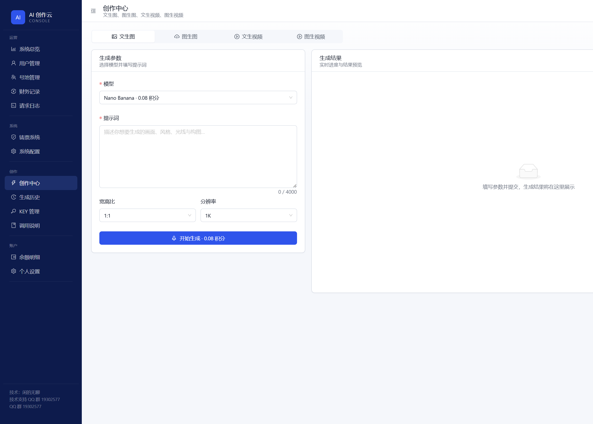
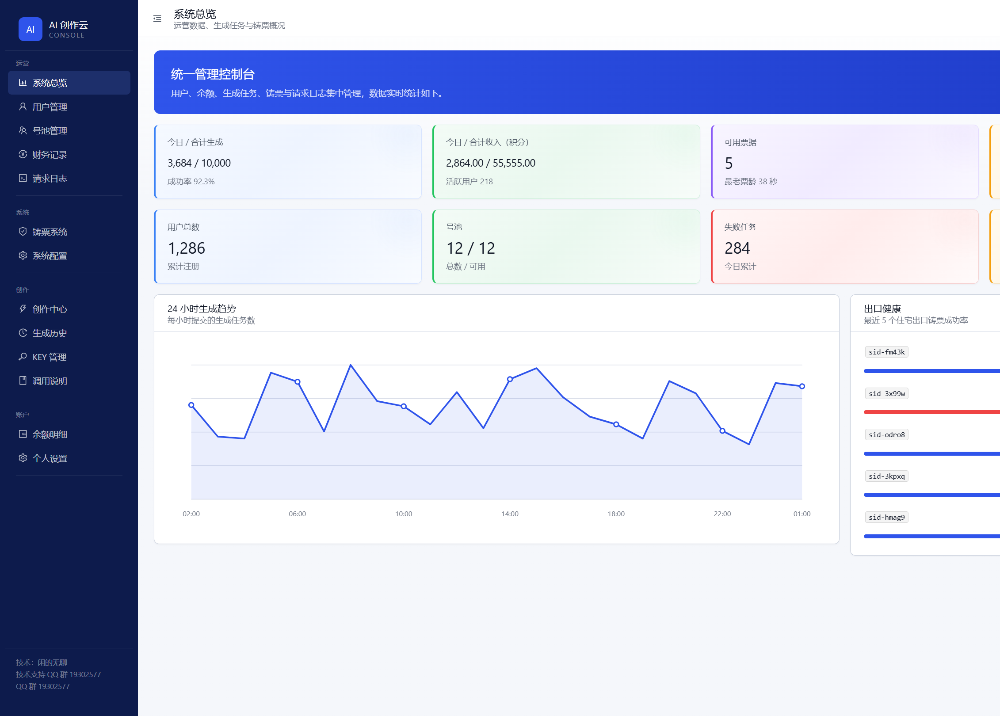

# AD小怪兽 · 生图 / 生视频 多用户中转平台

企业级 SaaS 后台风格（左右布局、蓝色科技感）的 AIGC 中转平台。用户在统一面板登录，在创作中心提交文生图 / 图生图 / 文生视频 / 图生视频，平台调度上游 **AD**，并做多用户计费、Key 管理与高并发调度。对外提供 OpenAI 与 Gemini 官方格式的同步/异步接口。

## 开源地址

**https://github.com/432539/adobe**

欢迎 Star / Fork。面板前端与仓库介绍均可直接打开该地址。

## 技术支持

**QQ 群：1109037692**（接入、部署、出图问题都在群里）

> 面向开发者的设计说明见 [`docs/`](./docs)。

## 界面预览

| 登录 | 创作中心 | 管理后台 |
|---|---|---|
|  |  |  |

## 技术栈

| 层 | 选型 |
|---|---|
| 后端 | Python 3.11 · FastAPI · SQLAlchemy 2.0 (async) · PostgreSQL · Redis |
| 出图链路 | **默认 AD 移动端**；仅部分模型走网页身份 |
| 前端 | React 18 · TypeScript · Ant Design (Pro Layout) · Vite |

## 目录结构

```
AD小怪兽/
├── docs/              # 设计文档
├── backend/           # FastAPI 后端
├── frontend/          # 控制台（含开源地址与 QQ 群）
└── harvester/         # 采集器占位（去过敏，不公开实现）
```

## 快速开始（开发）

参见 [`docs/07-dev-setup.md`](./docs/07-dev-setup.md)。最小路径：

```bash
docker compose up -d postgres redis   # 或本机已有 PostgreSQL / Redis
cp .env.example .env                  # 填 DATABASE_URL / REDIS_URL 等，勿提交 .env

# 后端
cd backend && pip install -e ".[dev]"
uvicorn app.main:app --reload --port 18000

# 前端
cd frontend && pnpm install && pnpm dev   # http://localhost:5173/
```

默认管理员见本地 `.env` 的 `ADMIN_USERNAME` / `ADMIN_PASSWORD`（勿把真实密码写进仓库）。

## 合规声明

本项目为技术研究与工程实现。上游账号、代理凭据、Cookie 等敏感数据一律加密存储、绝不入库明文、绝不提交仓库。
